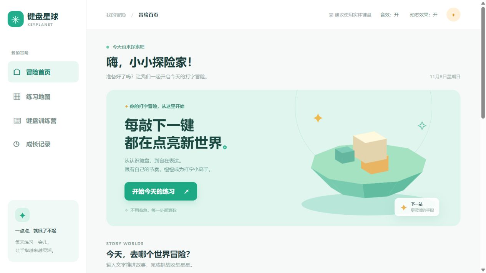
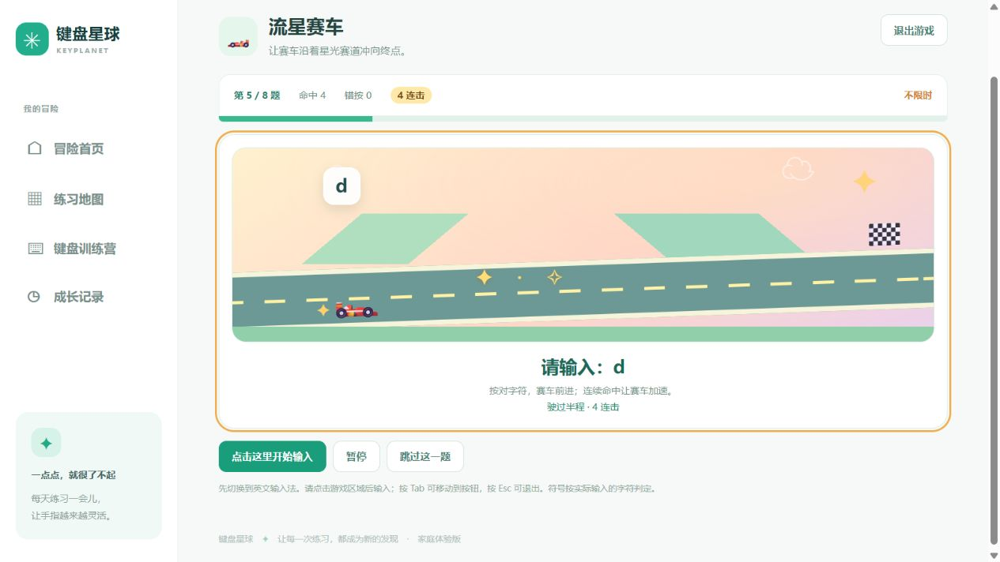
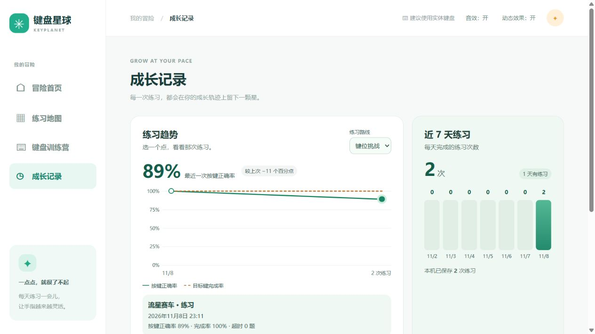

# 键盘星球 · KeyPlanet

[](https://github.com/topbat/keyplanet/actions/workflows/ci-release.yml)
[Apache License 2.0](LICENSE) · [下载发布版](https://github.com/topbat/keyplanet/releases/latest)

键盘星球是一款面向家庭和键盘初学者的中文网页打字游戏。你可以跟着故事练习打字，也可以在赛车、切水果和记忆游戏里熟悉键位。完成练习后，成长面板会帮你回看准确率、完成率和练习节奏。

KeyPlanet is a browser-based typing adventure for families and beginners. It combines keyboard drills, mini-games, Chinese input practice, and interactive progress charts.



## 功能

| 功能 | 体验 |
| --- | --- |
| 游戏冒险地图 | 20 个主题关卡，共用竞速、切水果、投靶、搭建和记忆五类玩法。支持字母、数字、符号与综合题库，也可选择难度、自由练习或限时考核。 |
| 键盘训练营 | 练习基础指位、字母和功能键，逐步熟悉实体键盘。 |
| 中文打字 | 跟着原创故事练习，或选择拼音、86 版五笔一级简码入门路线。拼音和故事中文输入使用系统已有的输入法。 |
| 场景与音效 | 答对推动场景进度，连击和阶段进度触发专属音效与特效。声音和动效可分别关闭。 |
| 成长记录 | 按路线看准确率曲线，点选数据查看单次成绩。键位挑战可对照完成率，柱状图展示近七天练习次数。 |
| 本地反馈 | 练习小伙伴根据当前浏览器的成绩和错键给出规则建议。数据保存在浏览器中，无需登录。 |

| 流星赛车的连击反馈 | 可点选的成长图表 |
| --- | --- |
|  |  |

## 环境搭建

推荐使用带实体键盘的电脑和现代浏览器。项目由原生 HTML、CSS 和 JavaScript 组成，`dist/` 是可直接运行和修改的前端源码。预览需要一个本地 HTTP 服务，下面以 Python 3 为例。

```bash
git clone https://github.com/topbat/keyplanet.git
cd keyplanet
python -m http.server 8080 --bind 127.0.0.1 --directory dist
```

打开 [http://127.0.0.1:8080](http://127.0.0.1:8080)。若系统将 Python 3 命令命名为 `python3`，用 `python3` 替换 `python`。页面通过 HTTP 加载 JavaScript 模块，建议通过上述地址预览。

### 运行测试

准备 Node.js 22.12 或更新版本。网页版和单元测试可直接运行。桌面开发和打包依赖 Electron。

```bash
npm test
```

### 安装桌面版或下载网页版

从 [GitHub Releases](https://github.com/topbat/keyplanet/releases/latest) 按设备选择下载文件。

| 平台 | 文件后缀 | 安装方式 |
| --- | --- | --- |
| Windows 64 位 | `windows-x64-setup.exe` | 运行安装程序。 |
| macOS Apple 芯片 | `macos-arm64.dmg` | 打开磁盘映像，将 KeyPlanet 拖入「应用程序」。 |
| macOS Intel 芯片 | `macos-x64.dmg` | 打开磁盘映像，将 KeyPlanet 拖入「应用程序」。 |
| 网页版 | `web.zip` | 解压后从包根目录运行上面的 HTTP 服务命令，或将 `dist/` 部署到静态站点。 |

在 Mac 上可通过「关于本机」查看芯片类型。Windows 安装包未签名，macOS 应用采用临时签名且未经 Apple 公证，首次打开时系统可能提示确认。桌面版支持离线使用，练习记录保存在本机应用内。各下载文件的校验值见同一版本中的 `SHA256SUMS.txt`。

### 本地运行桌面版

```bash
npm ci
npm exec -- install-electron
npm run desktop
```

在 Windows 上运行 `npm run package:desktop -- --win --x64` 可生成安装程序。在 macOS 上运行 `npm run package:desktop -- --mac --x64 --arm64` 可生成两种磁盘映像。输出目录为 `release/`。

## 项目结构

| 路径 | 用途 |
| --- | --- |
| `dist/` | 页面、样式、游戏、评分逻辑和成长图表 |
| `desktop/` | Electron 桌面入口和本地资源协议 |
| `tests/` | 使用 Node.js 内置测试框架运行的测试 |
| `CHANGELOG.md` | [中文修改历史](CHANGELOG.md) |
| `docs/` | [玩法调研](docs/game-research.md)、[练习反馈设计](docs/ai-workflow.md)及项目截图 |
| `.github/workflows/` | GitHub Actions 测试、打包和发布流程 |

## 持续集成与发布

向 `main` 推送或提交拉取请求时，GitHub Actions 会运行测试、检查脚本语法和中文修改历史，并扫描依赖漏洞、Git 历史中的密钥和 Actions 工作流配置。推送到 `main` 时还会构建并启动验证三个桌面安装包。

发布前，同步更新 `package.json` 和 `package-lock.json` 的版本，并在 [修改历史](CHANGELOG.md) 添加 `## [版本号] - YYYY-MM-DD` 章节及中文条目。将这些改动提交到 `main`，等待 CI 通过后推送对应的 `v<版本号>` 标签。标签触发测试、扫描与原生构建，全部通过后自动创建 GitHub Release。正文使用该版本的中文修改历史，附件包括网页 ZIP、三个桌面安装包及 SHA-256 校验文件。

## 参与贡献

欢迎通过 GitHub Issues 报告问题或提出玩法建议。提交改动时，请说明复现或验证步骤，并运行 `npm test`。涉及界面的改动可以附上截图。

## 开源协议

本项目采用 [Apache License 2.0](LICENSE)。版权声明见 [NOTICE](NOTICE)。
